# Figures

These figures are re-generated with major _MagicSoup_ updates.
For details see the source code that generated each figure
[here (github.com)](https://github.com/mRcSchwering/magic-soup/blob/main/docs/create_figures.py).

## 1. Genomes

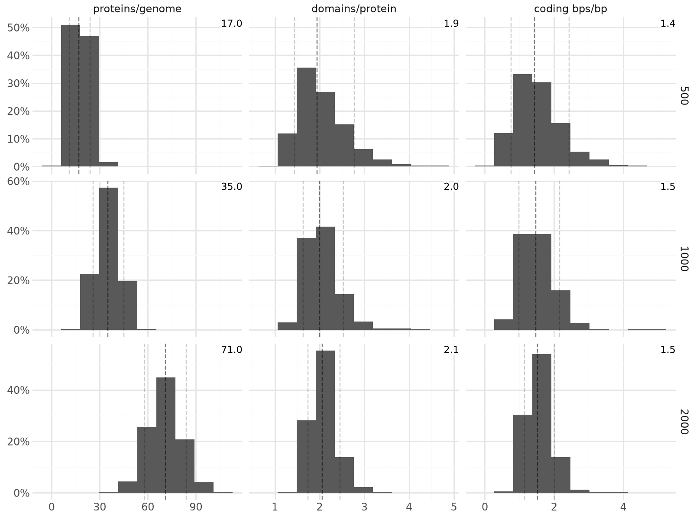

_**1.1. Genome compositions at different genome sizes.**
1000 random genomes of lengths 500, 1000, or 2000 each were generated, transcribed, and translated.
For every cell the number proteins per genome, domains per protein, and coding base pairs per base pair were recorded.
Coding base pairs are base pairs which are part of at least 1 domain.
Heavy dashed lines and numbers describe medians.
Light dashed lines describe 10% and 90% percentiles.
There were 3 start and 3 stop codons.
Each domain type appeared with a frequency of 5% in all 2-codon tuples._

 

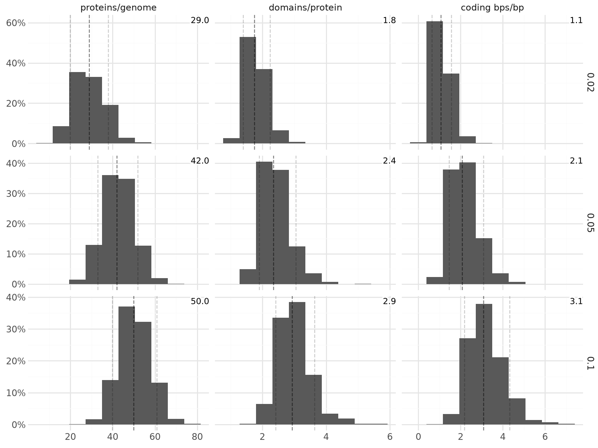

_**1.2. Genome compositions at different domain probabilities.**
1000 random genomes of length 1000 with 2-codon domain type frequencies 2%, 5%, or 10% each were generated, transcribed, and translated.
For every cell the number proteins per genome, domains per protein, and coding base pairs per base pair were recorded.
Coding base pairs are base pairs which are part of at least 1 domain.
Heavy dashed lines and numbers describe medians.
Light dashed lines describe 10% and 90% percentiles.
There were 3 start and 3 stop codons._

 

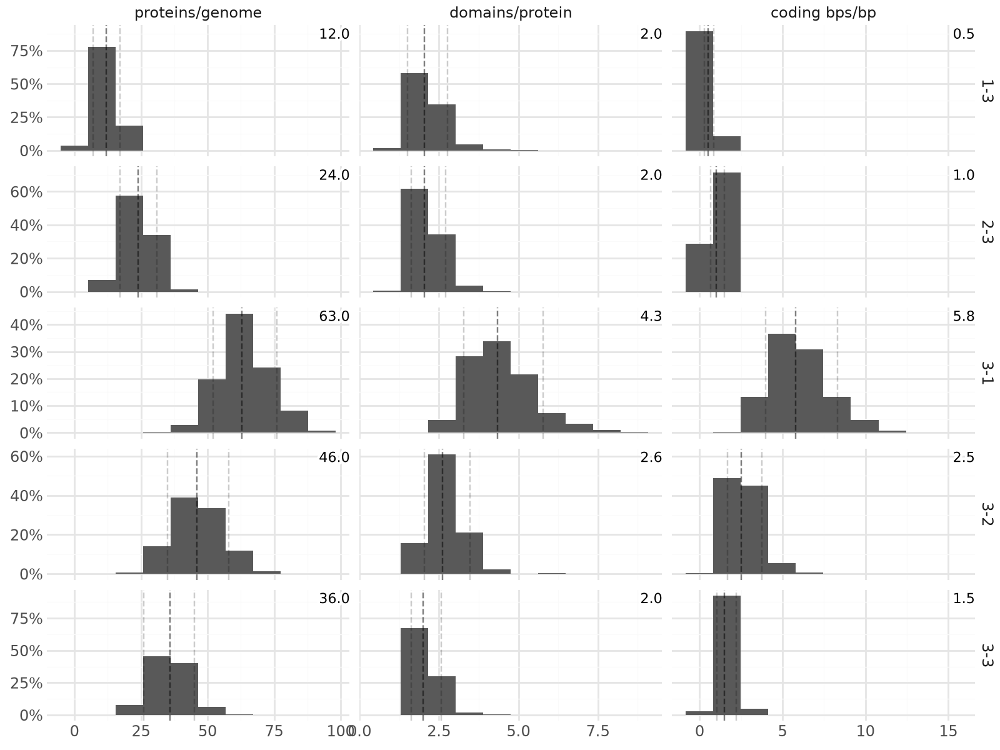

_**1.3. Genome compositions at different start stop codon combinations.**
1000 random genomes of length 1000 with combinations of 1 to 3 start and 1 to 3 stop codons each were generated, transcribed, and translated.
For every cell the number proteins per genome, domains per protein, and coding base pairs per base pair were recorded.
Coding base pairs are base pairs which are part of at least 1 domain.
Heavy dashed lines and numbers describe medians.
Light dashed lines describe 10% and 90% percentiles.
Facetting labels on the right describe first the number of start codons, second the number of stop codons.
Each domain type appeared with a frequency of 5% in all 2-codon tuples._

 

## 2. Transcriptomes

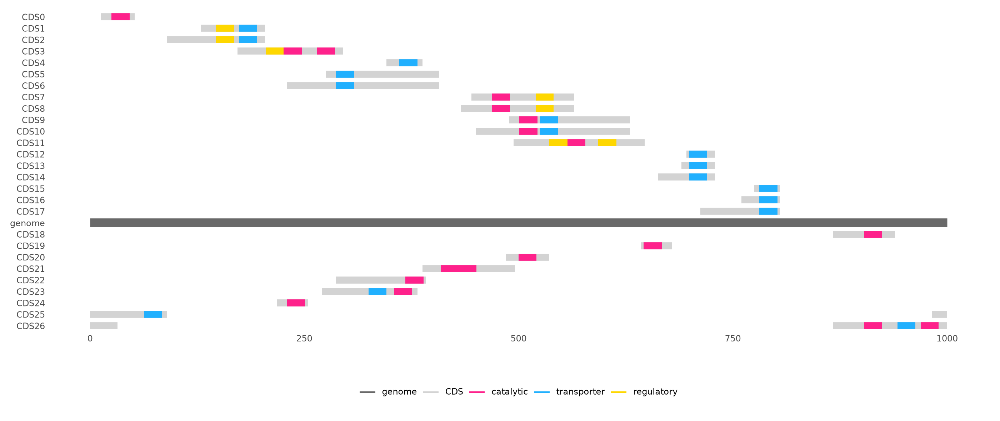

_**2.1. Transcriptome of a cell with a random genome of length 1000.**
Each CDS will be translated into a protein with all coupled domains.
The dark gray bar represents 5'-3' genome, light gray bars transcripts.
Transcripts above the genome are found on the genome in 5'-3' direction, below on the reverse-complement.
Colored bars represent domains on transcripts: transporer, catalytic, regulatory.
Transcripts and domains are aligned with their respective positions on the genome._

 

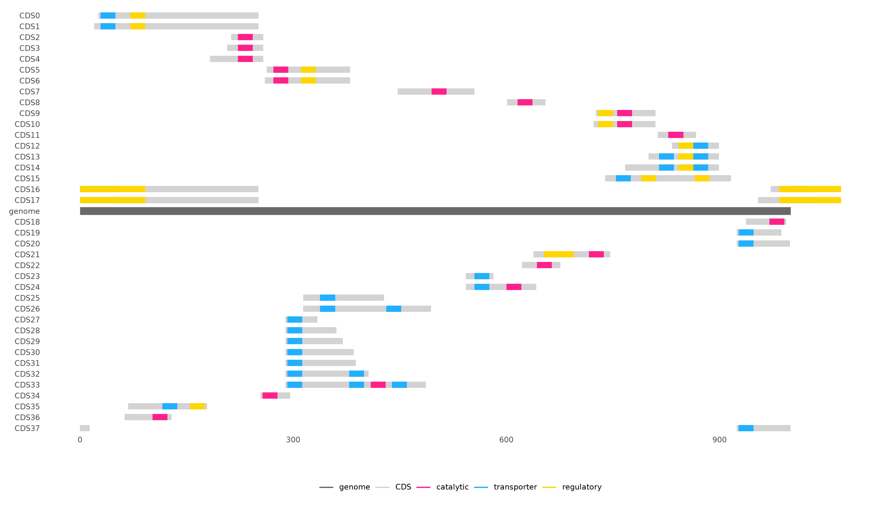

_**2.2. Transcriptome of a cell with a random genome of length 1000.**
Each CDS will be translated into a protein with all coupled domains.
The dark gray bar represents 5'-3' genome, light gray bars transcripts.
Transcripts above the genome are found on the genome in 5'-3' direction, below on the reverse-complement.
Colored bars represent domains on transcripts: transporer, catalytic, regulatory.
Transcripts and domains are aligned with their respective positions on the genome._

 

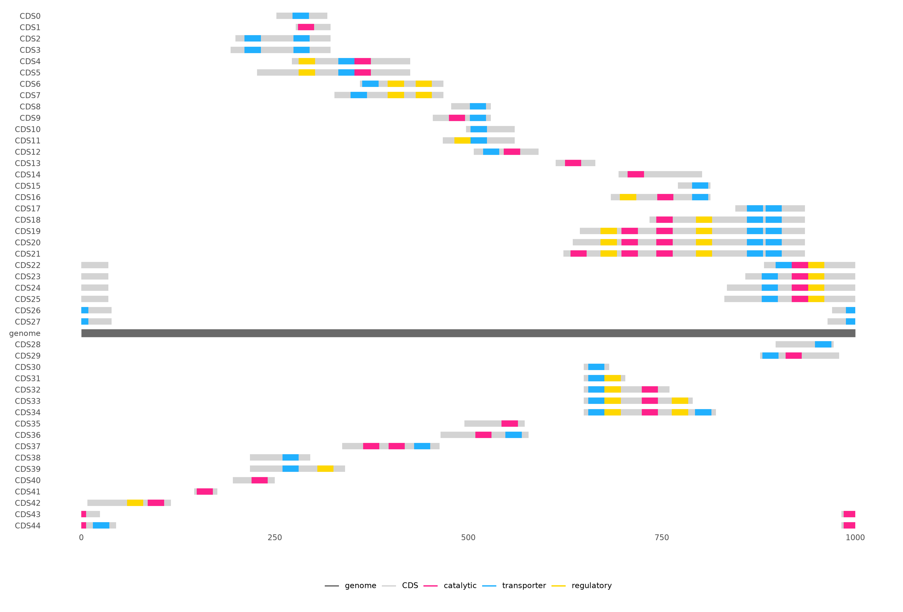

_**2.3. Transcriptome of a cell with a random genome of length 1000.**
Each CDS will be translated into a protein with all coupled domains.
The dark gray bar represents 5'-3' genome, light gray bars transcripts.
Transcripts above the genome are found on the genome in 5'-3' direction, below on the reverse-complement.
Colored bars represent domains on transcripts: transporer, catalytic, regulatory.
Transcripts and domains are aligned with their respective positions on the genome._

 

## 3. Mutations

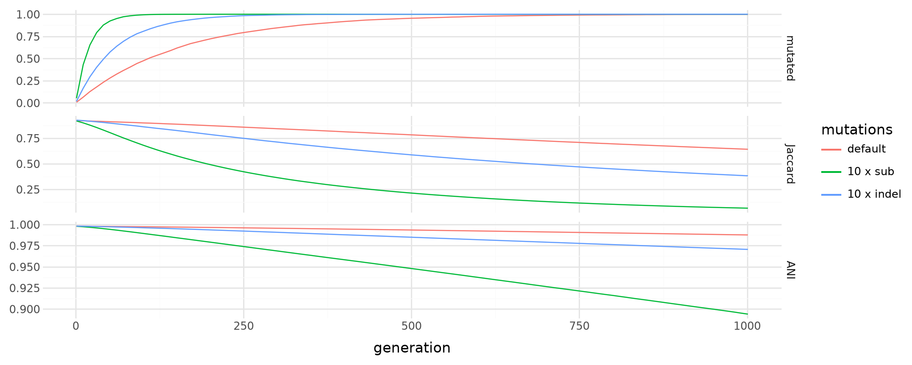

_**3.1 Accumulation of mutations.**
Accumulated mutations over generations shown as
ratio of muated genomes (top),
21-mer Jaccard similarity (middle),
Jaccard-derived (Mash) ANI (bottom)
for default mutations settings (red),
10-fold increased substitution rate (green),
10-fold increased indel rate (blue)
in 1000 base pair long genomes.
Default mutation settings have per base pair rates of
1E-5 for substitutions and 1E-6 for indels._

 

## 4. Molecule Physics

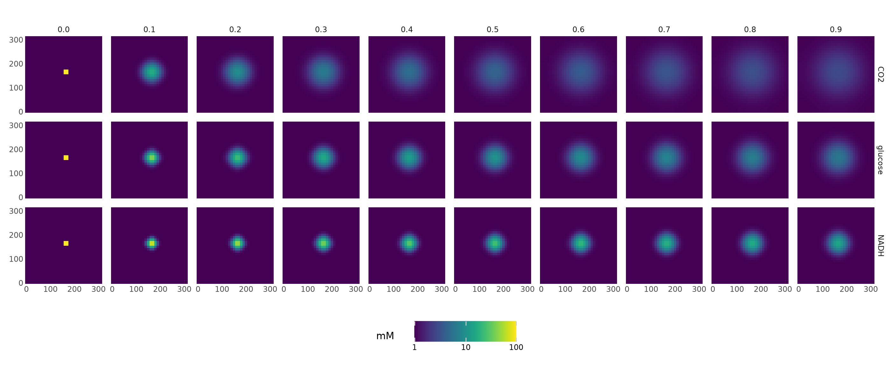

_**4.1. Molecule diffusion.**
Small world maps were filled with a 100&nbsp;mM of a molecule species in the middle and 1&nbsp;mM in the periphery.
Columns represent time in seconds from left to right, rows show different molecule species.
Diffusion coefficients were set to 1.9E-5&nbsp;cm²/s for CO2, 6.7E-6&nbsp;cm²/s for glucose, 2.5E-6&nbsp;cm²/s for NADH.
Map dimensions are in µm._

 

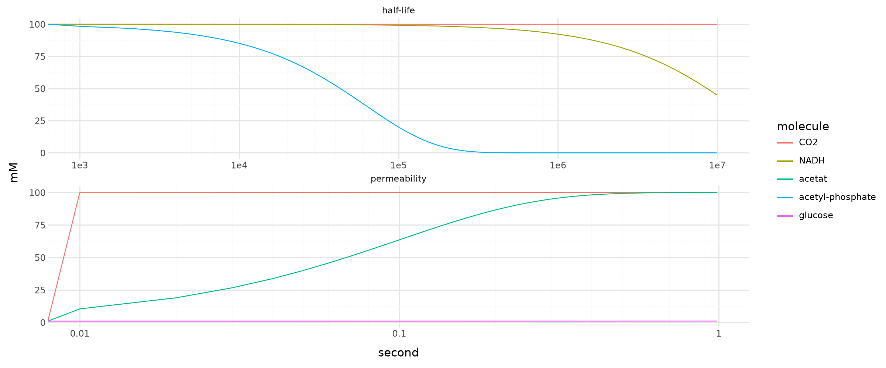

_**4.2. Molecule permeation and degradation.**
Top row shows molecule degradation of 100&nbsp;mM CO2, NADH, acetyl-phosphate
with half-lifes of $\infty$, 0.5&nbsp;days, 100&nbsp;days respectively over the course of 115&nbsp;days.
Bottom row shows molecule permeation of 100&nbsp;mM extracellular CO2, acetat, glucose through
the cell membrane with permeability coefficients of 0.35&nbsp;cm/s, 2E-4&nbsp;cm/s, 1E-8&nbsp;cm/s respectively
over the course of 10&nbsp;s._

 

## 5. Parameter Distributions

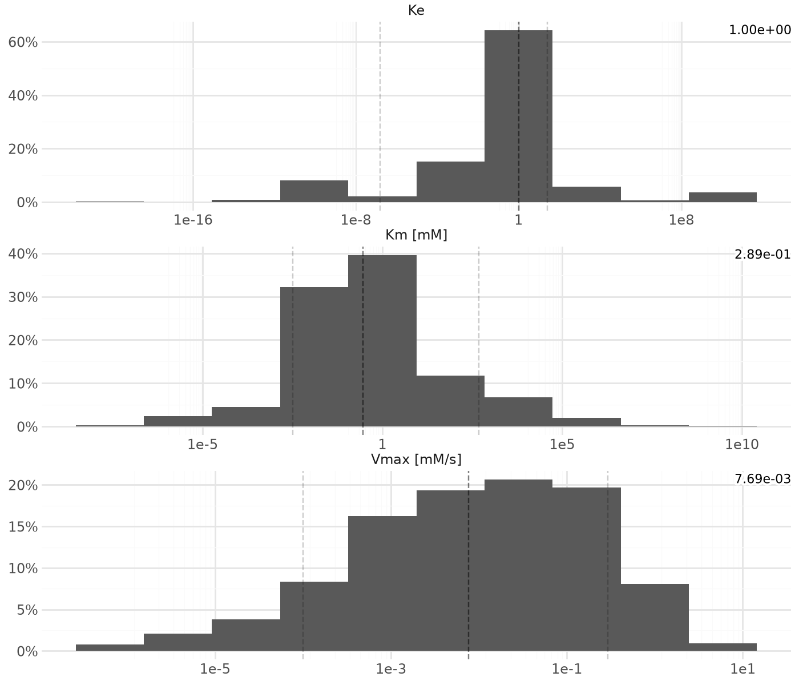

_**5.1. Continuous Parameter Distributions.**
Each row shows a snapshot of a parameter distribution of the proteins in a simulation with 1000 random cells with 1000 base pair long genomes each.
The top rows shows the equilibrium constant ($K_E$) distribution.
The middle row shows an equivalent of the Michaelis Menten constant ($K_M$) distribution in mM.
The bottom row shows the maximum velocity ($v_{max}$) distribution in mM/s assuming constant protein concentration of 1&nbsp;µM.
Heavy dashed lines and top right numbers show medians, light dashed lines show 10% and 90% percentiles._

 

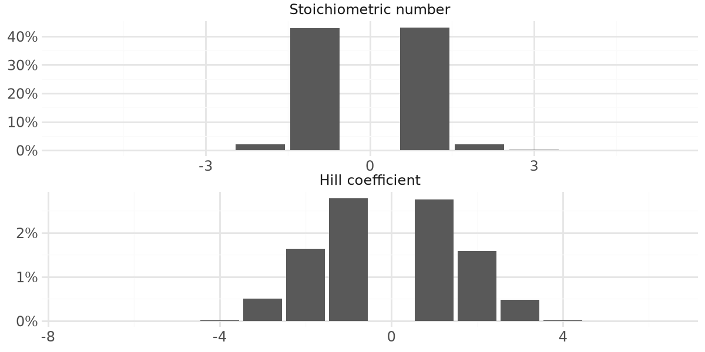

_**5.2. Discrete Parameter Distributions.**
Each row shows a snapshot of a parameter distribution of the proteins in a simulation with 1000 random cells with 1000 base pair long genomes each.
The top rows shows the distribution of stoichiometric numbers of the catalyzed reactions.
The bottom row shows the distribution of Hill coefficients of allosteric domains._

 

## 6. Simple Kinetics

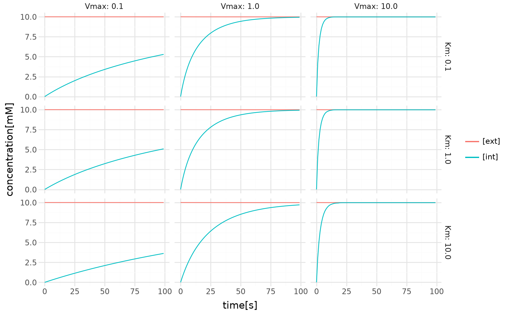

_**6.1. Molecule import over time.**
Intra- and extracellular molecule concentrations over time
of a cell with a single transporter protein for this molecule species.
Rows show transport at different transporter $K_{\text{M}}$, columns at different $V_{\text{max}}$._

 

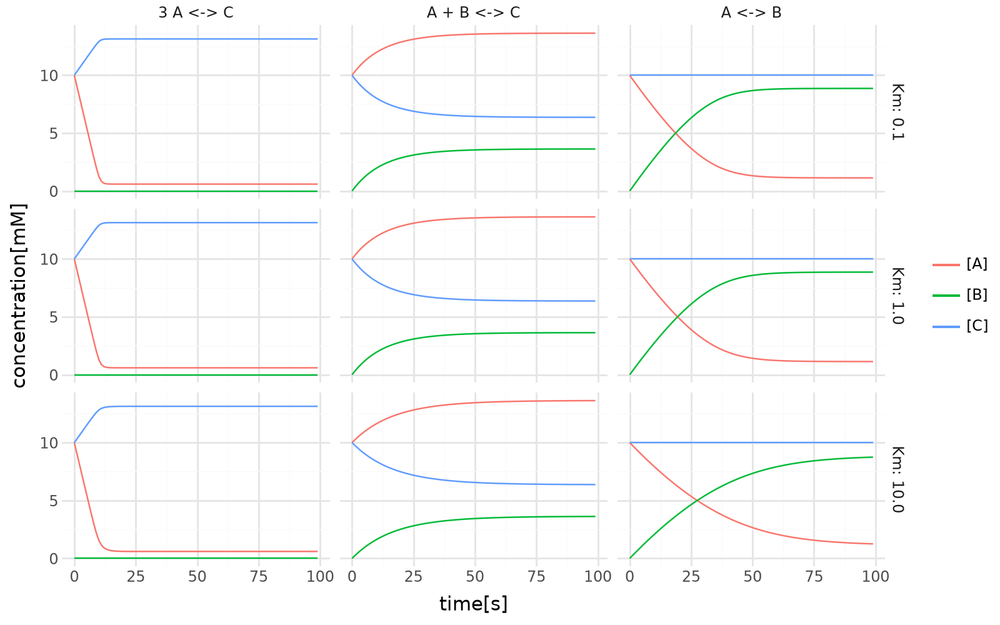

_**6.2. Sample reactions catalyzed over time.**
Intracellular molecule concentrations over time in a cell with one protein that catalyzes
3A $\rightleftharpoons$ C | -10 kJ (left column),
A + B $\rightleftharpoons$ C | 5 kJ (middle column),
A $\rightleftharpoons$ B | -5 kJ (right column).
Rows show different Km values for the protein._

 

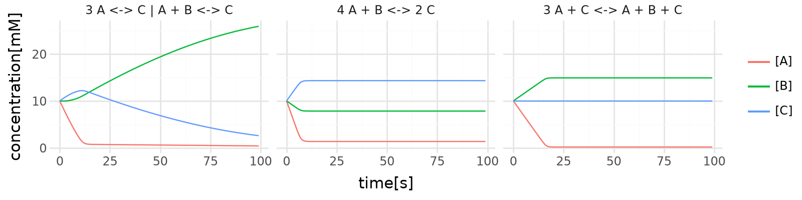

_**6.3. Uncoupled and coupled catalysis over time.**
Intracellular molecule concentrations over time in a cell with
two proteins that catalyze 
3A $\rightleftharpoons$ C | -10 kJ and A + B $\rightleftharpoons$ C | 5 kJ (left column),
one protein that catalyzes 4A + B $\rightleftharpoons$ 2C | -5 kJ (middle column),
one protein that catalyzes 3A + C $\rightleftharpoons$ A + B + C | -15 kJ (right column)._

 

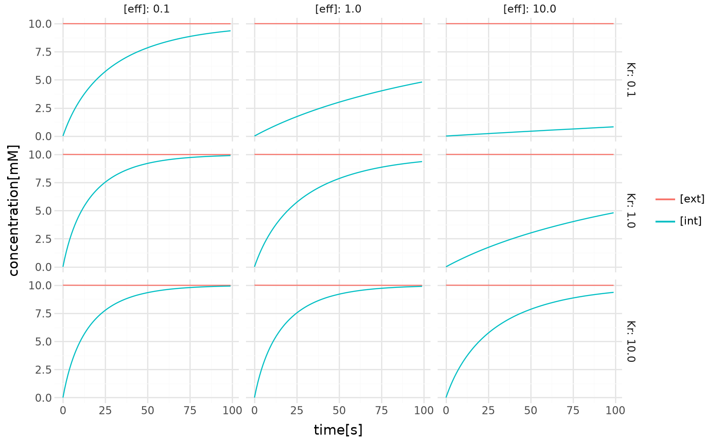

_**6.4. Inhibited molecule import over time.**
Intra- and extracellular molecule concentrations over time
of a cell with a single regulated transporter protein for this molecule species.
Rows show transport at different inhibitor affinities (analog to $K_{\text{M}}$), columns at different inhibitor concentrations._

 

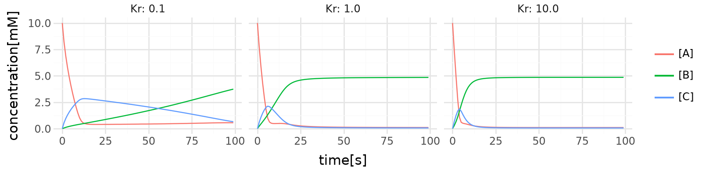

_**6.5. Molecule catalysis with negative feedback over time.**
Intracellular molecule concentrations over time in a cell with a protein
that catalyze A + B $\rightleftharpoons$ C | 5 kJ and is inhibited by C and a protein that catalyzes 3A $\rightleftharpoons$ C | -10 kJ and is inhibited by B.
Columns show catalysis at different inhibitor affinities (analog to $K_{\text{M}}$) of both regulatory regions._

 

## 7. Biochemical Patterns

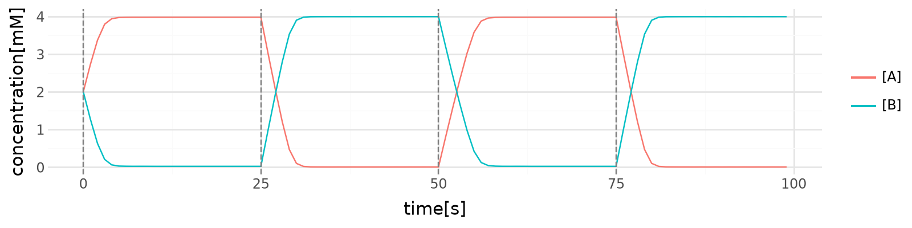

_**7.1. Switch with relay controlled by third molecule.**
Intracellular molecule concentrations over time in a cell with one protein that catalyzes A + E $\rightleftharpoons$ B | -10 kJ and is inhibited by C and one protein that catalyzes B + E $\rightleftharpoons$ A | -10 kJ and is activated by C.
E was supplied in abundance and C was alternated between high and low concentrations at time points shown as dashed vertical lines._

 

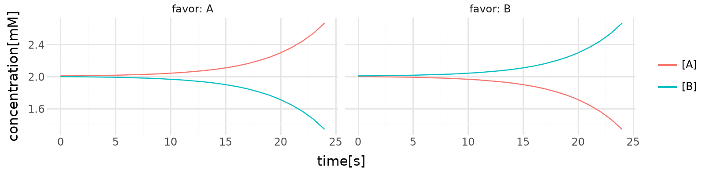

_**7.2. Bistable switches from competing enzymes.**
Intracellular molecule concentrations over time in a cell with one protein that
catalyzes A + E $\rightleftharpoons$ B | -10 kJ and is inhibited by A
and one protein that catalyzes B + E $\rightleftharpoons$ A | -10 kJ and is inhibited by B.
E was provided in abundance.
Slight variation in initial A and B concentrations favor either molecule._

 

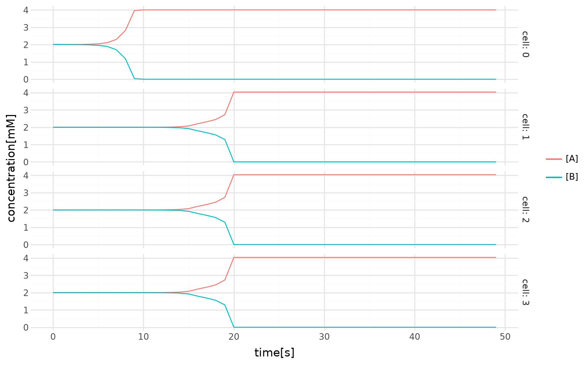

_**7.3. Signal propagation through neighbouring cells with bistable switches.**
Intracellular molecule concentrations over time in multiple neighbouring cells that all have one protein that catalyzes A + E $\rightleftharpoons$ B | -10 kJ and is inhibited by A
and one protein that catalyzes B + E $\rightleftharpoons$ A | -10 kJ and is inhibited by B, as well as transporters for A and B.
E was provided in abundance.
Slight variation in initial concentrations in cell 0 favor one molecule.
The concentration change eventually arrives at the other cells and also makes them favor the same molecule._

 

## 8. Free Energy in Simulation

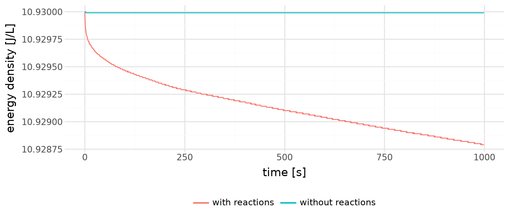

_**8.1. Energy density over time.**
Energy density in J/L shown over time for a simulation that includes reactions 
in its chemistry (red) and one that doesn't (blue)._

 

## 9. Passaging

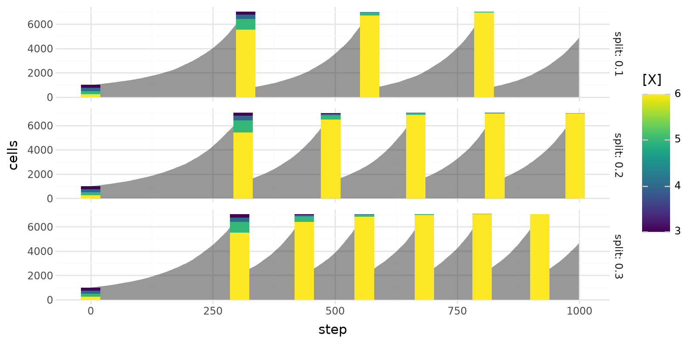

_**9.1. Selection by random passaging over time.**
Simulated cell growth of 4 cell lines with different growth rates.
Gray areas describe overall cell number at each step,
colored bars describe a passage with colors indicating relative cell line abundances
before the passage.
At each step a cell can divide or die depending on molecule concentration x
with probabilities $p_{divide} = x^5 / (x^5 + 15^5)$ and $p_{die} = 1^7 / (x^7 + 1^7)$ respectively.
Cell lines differ in their intracellular x concentrations as indicated by colors.
Passaging is always done randomly when total cell number reaches 7000.
Rows show different passaging ratios._

 
