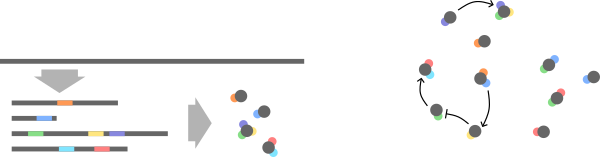
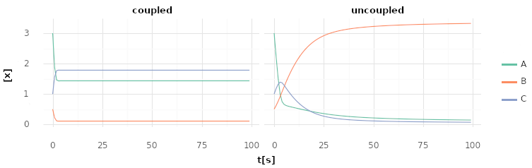

# Mechanics

The simulation is an agent-based 2D spatio-temporal simulation.
Cells are agents. Each cell has a string, the genome, which unambigously encodes a set or proteins, the proteome.
These proteins can change molecules in and around the cell.
Through that each cell can process information.
Cell proteomes can form complex networks with hubs, feedback loops, cascades, and oscillators.
When randomly changing a cell genomes, their networks change randomly, too.
By selectively replicating certain cells while killing others, cells can evolve.

- [World Map](#world-map) explains world dimensions with diffusion, permeation, cells
- [Genetics](#genetics) explains how gene translation works in this simulation
- [Chemistry](#chemistry) explains molecules, reactions and energy coupling
- [Kinetics](#kinetics) explains protein reaction and transporter kinetics

I believe that most interesting behaviors take time to evolve.
That's why the mechanics in this simulation are simplified a lot.
It is a tradeoff between a reasonable amount of complexity and performance.

## World Map

The world in which cells can divide and move around is seen as a $N^2$ periodic grid of ${\Delta x}^3$ voxels.
By default $N$ is 128 and $\Delta x$ is 10&nbsp;µm.
Thus the default world map spans around 1,64&nbsp;mm² and contains 16&nbsp;nL.
Molecules can diffuse between voxels according to their [diffusion coefficient](https://en.wikipedia.org/wiki/Mass_diffusivity) (in cm²/s) however each voxel itself is regarded as a well-mixed compartment.
See [Model > Diffusion](./methods.md#diffusion) more details on diffusion.

Each voxel can contain at most one cell.
By default each cell is modelled as a 1&nbsp;fL sphere swimming in a voxel.
Its contents are separated from the voxel's contents by a membrane.
Molecules may permeate this membrane if their [permeability coefficient](https://en.wikipedia.org/wiki/Permeability_(porous_media)) (in cm/s) allows it.
See [Model > Permeation](./methods.md#permeation) more details on diffusion.

A cell can migrate from its current voxel into an empty voxel in its [Moore neighbourhood](https://en.wikipedia.org/wiki/Moore_neighborhood).
When a cell divides a new descendant cell appears in an empty voxel in its Moore neighbourhood.
Upon division both cells share all molecules of its ancestor cell equally.
Thus, molecule concentrations drop immediately after division.
When a cell dies it spills all its contents into the inhabited voxel,
thus leading to a small concentration uptick in the voxel.

## Genetics

Mechanisms are similar to bacterial [translation](<https://en.wikipedia.org/wiki/Translation_(biology)>).
A cell's [genome](https://en.wikipedia.org/wiki/Genome) is a chain of [nucleotides](https://en.wikipedia.org/wiki/Nucleotide) represented by a string of letters
T, C, G, A. There are [start and stop codons](https://en.wikipedia.org/wiki/Genetic_code) which define [coding regions (CDSs)](https://en.wikipedia.org/wiki/Coding_region).
Transcription can start at any start codon and will end when the first [in-frame](https://en.wikipedia.org/wiki/Reading_frame) stop codon encountered.
CDSs without a stop codon are not considered [[James NR 2016](https://pubmed.ncbi.nlm.nih.gov/27934701/)].
It differs to [real-life transcription](https://en.wikipedia.org/wiki/Transcription_(biology)) in that there are no promotor and terminator sequences.
Each CDS is translated into one protein, giving each cell a certain [proteome](https://en.wikipedia.org/wiki/Proteome).
What each protein can do is defined by its [domains](https://en.wikipedia.org/wiki/Protein_domain).

_A cells genome is transcribed into multiple coding regions, each of which forms a protein. Each coding region can contain multiple domains of which each has a different purpose and different kinetics. Together these proteins can form metabolic and transduction networks in the cell._

There are three domain types: _catalytic, transporter, regulatory_.
Each domain consists of a region of genetic code that defines the domain type itself
and several regions that define its further specifications.
What these specifications are depends on the domain type.

_Catalytic_ domains can catalyze one reaction each.
All possible reactions are defined in the simulation's chemistry (see [Chemistry](#chemistry)).
Specifications are the catalyzed reaction, affinities for substrates and products,
maximum velocity, domain orientation (see [Energy](#energy)).

_Transporter_ domains can move molecules across the cell membrane,
_i.e._ from the voxel medium into the cell and _vice versa_.
All possible molecule species are defined in the simulation's chemistry (see [Chemistry](#chemistry)).
Specifications are the molecule species, affinity, maximum velocity, domain orientation (see [Energy](#energy)).

_Regulatory_ domains can regulate a protein through an effector molecule.
A protein with only a regulatory domain has no function.
But if the protein also has a catalytic or transporter domain, the regulatory
domain can up- or down-regulate this domain.
Specifications are the effector molecule species,
a [hill coefficient](https://en.wikipedia.org/wiki/Hill_equation_(biochemistry)),
whether it is activating or inhibiting, the affinity of the effector.

Affinity and maximum velocity are kinetic parameters which are described in [Kinetics](#kinetics) in more detail.
Which specific combination of nucleotides encodes which specific parameter, _e.g._ a particular maximum velocity value,
is defined by mappings generated once when the simulation [World][magicsoup.world.World] is instantiated.

Genes are translated instantaneously.
So, if a genome mutates, changes immediately manifest in the proteome.
There is also no transcriptional and post-transcriptional regulation.
Location and efficiency of CDSs are not taken into consideration.
Each protein is always present at a constant concentration (1&nbsp;µM by default).
However, if a CDS is duplicated, so is it's protein and thus so is it's combined velocity.
Some example transcriptomes and biochemical patterns are shown in
[figures 2](./figures.md#2-transcriptomes) and [figures 7](./figures.md#7-biochemical-patterns).

## Chemistry

At the beginning of a simulation the user has to define which molecule species exist
and which reactions are possible.
Molecule species are defined with a half-life, diffusivity, permeability, and an internal energy value.
This energy is the hypothetical energy that this molecule would release if it was fully deconstructed.
Reactions define how molecule species can be converted.
They are all reversible (see [Kinetics](#kinetics) for details).
Here, the simulation takes [Gibbs free energy](https://en.wikipedia.org/wiki/Gibbs_free_energy) as an analogy:

$$
\Delta G_0 = \sum^{products}{n_j E_{P,j}} - \sum^{substrates}{n_i E_{S,i}}
$$

where $\Delta G_0$ is the standard Gibbs free energy of the reaction,
$E_{S,i}$ is the energy of substrate $i$ with stoichiometric coefficient $n_i$,
and $E_{P,j}$ is the energy of product $j$ with stoichiometric coefficient $n_j$.
It is used to calculate an [equilibrium constant](https://en.wikipedia.org/wiki/Equilibrium_constant)
$K_e$ for this reaction.

$$
\frac{-\Delta G_0}{\text{R}T} = \ln K_e
$$

where $\text{R}$ is the [gas constant](https://en.wikipedia.org/wiki/Gas_constant) and $T$ is the temperature (in Kelvin).
As further described in [Kinetics](#kinetics) the [reaction quotient](https://en.wikipedia.org/wiki/Reaction_quotient)
always moves towards $K_e$.
So, reactions always move in a energetically favourable direction.

However, all reactions catalyzed by the same protein are considered to be energetically coupled.
All domains are considered when calculating $\Delta G_0$.
Thus, an energetically unfavourable reaction can progress if it is powered by an energetically favourable one.
In which orientation these domains are energetically coupled
is defined in the domain itself as a region that encodes a boolean $\{0;1\}$.
All domains with orientation $0$ work from left to right, and _vice versa_ for $1$.
_E.g._ if there are 2 catalytic domains $A \rightleftharpoons B$ and $C \rightleftharpoons D$,
they would become $A + C \rightleftharpoons B + D$ if they have the same orientation,
and $A + D \rightleftharpoons B + C$ if not.

_Uncoupled and coupled catalysis over time.
Molecule concentrations inside a cell while it catalyzes 3A $\rightleftharpoons$ C | -10 kJ
and A + B $\rightleftharpoons$ C | 5 kJ each step.
Left shows a cell with a single protein with 2 domains which are energetically coupled
as 4A + B $\rightleftharpoons$ 2C | -5 kJ.
Right shows a cell with 2 proteins with a single domain each for both reactions respectively._

Transporter domains are also involved this way.
A transporter is seen as a reaction that converts an intracellular molecule to its extracellular version (and _vice versa_).
For a transporter $\Delta G_0$ is always zero.
Thus, a transporter can drive another reaction while molecules are allowed to diffuse along
their concentration gradient, or another reaction can drive a transporter to pump molecules
against their concentration gratient.

## Kinetics

All reactions in this simulation are based on [reversible Michaelis-Menten kinetics](https://en.wikipedia.org/wiki/Reversible_Michaelis%E2%80%93Menten_kinetics).
In the simplest case enzyme (E) forms a complex (ES) with substrate (S) and modifies it to product (P).
P can bind E again and react back to S.

$$
\text{E} + \text{S} \overset{k_1}{\underset{k_{-1}}{\rightleftharpoons}} \text{ES}
\overset{k_2}{\underset{k_{-2}}{\rightleftharpoons}} \text{E} + \text{P}
$$

Here, $k_1$, $k_{-1}$, $k_2$, $k_{-2}$ are the forward and reverse rates for the first and second step.
If $c_E$ is the total enzyme concentration ($\text{E}$ and $\text{ES}$),
maximum forward and backward velocities and be defined as
$v_{max,f} = k_2 c_E$ and $v_{max,b} = k_{-1} c_E$.
Then, reaction velocity can be described with the reversible Michaelis-Menten equation

$$
v_{\text{S} \rightleftharpoons \text{P}} =
\frac{\text{d}c_P}{\text{d}t} =
\frac{v_{max,f} \frac{c_S}{k_f} - v_{max,b} \frac{c_P}{k_b}}{1 + \frac{c_S}{k_f} + \frac{c_P}{k_b}}
$$

where $c_S$ and $c_P$ are concentrations of substrate and product,
$k_f = (k_{-1} + k_2) / k_1$ and $k_b = (k_{-1} + k_2) / k_{-2}$.
In the simulation, these kinetics are further simplified by assuming a constant $c_E$ for each enzyme in all cells (1&nbsp;µM by default) and by assuming the same maximum velocity in both directions $v_{max,f} = v_{max,b} = v_{max}$.
The equation can then be re-written as

$$
v_{\text{S} \rightleftharpoons \text{P}} =
\frac{\text{d}c_P}{\text{d}t} =
v_{max} \frac{\frac{c_S}{k_f} - \frac{c_P}{k_b}}{1 + \frac{c_S}{k_f} + \frac{c_P}{k_b}}
= v_{max} \alpha_{cat, \text{S} \rightleftharpoons \text{P}}
$$

where $\alpha_{cat}$ describes the catalytic activity of this protein.
More generically, the catalytic activity of any protein can be described using its catalyzed reaction stoichiometry.
With $c_i$ as the concentration of substrate $i$ with stoichiometric coefficient $n_i$
and $c_j$ as the concentration of product $j$ with stoichiometric coefficient $n_j$
its catalytic activity is

$$
\alpha_{cat} =
\frac{\frac{1}{k_f} \prod^{\text{substrates}} c_i^{n_i} - \frac{1}{k_b} \prod^{\text{products}} c_j^{n_j}}{1 + \frac{1}{k_f} \prod^{\text{substrates}} c_i^{n_i} + \frac{1}{k_b} \prod^{\text{products}} c_j^{n_j}}
$$

As mentioned in [Genetics](#genetics) a protein can contain
regulatory domains which regulate the protein [non-competitively](https://en.wikipedia.org/wiki/Non-competitive_inhibition).
Allosteric regulation $\alpha_{reg}$ is modeled as

$$
\alpha_{reg} =
\prod^{\text{effectors}} \frac{c_l^{h_l}}{c_l^{h_l} + k_{r,l}^{h_l}}
$$

where $c_l$ is the concentration of effector molecule $l$,
$h_l$ is its hill coefficient,
and $k_{r,l}$ is its effector concentration producing half occupation.
$h_l > 0$ creates activating effectors, $h_l < 0$ inhibiting effectors.
Proteins without regulatory domains are always active.
As a result, the velocity of a protein in a cell is modeled as

$$
v = \begin{cases}
  v_{max} \alpha_{cat} \alpha_{reg},     & \text{if any } h_l \ne 0 \\
  v_{max} \alpha_{cat},             & \text{otherwise}
\end{cases}
$$

Values for $v_{max}$, $n$, $k_r$, $h$ are derived from domain specifications of the gene that encodes the protein (see [Genetics](#genetics)).
Another domain specification defines an affinity from which $k_f$ and $k_b$ is derived so that

$$
\frac{k_b}{k_f} = K_e
$$

This ensures that over time the [reaction quotient](https://en.wikipedia.org/wiki/Reaction_quotient) progresses towards the [equilibirum constant](https://en.wikipedia.org/wiki/Equilibrium_constant) $K_e$ and thus reactions always progress into an energetically favourable direction (also see [Chemistry](#chemistry)).
For more details see [Model > Kinetics](./methods.md#kinetics)
