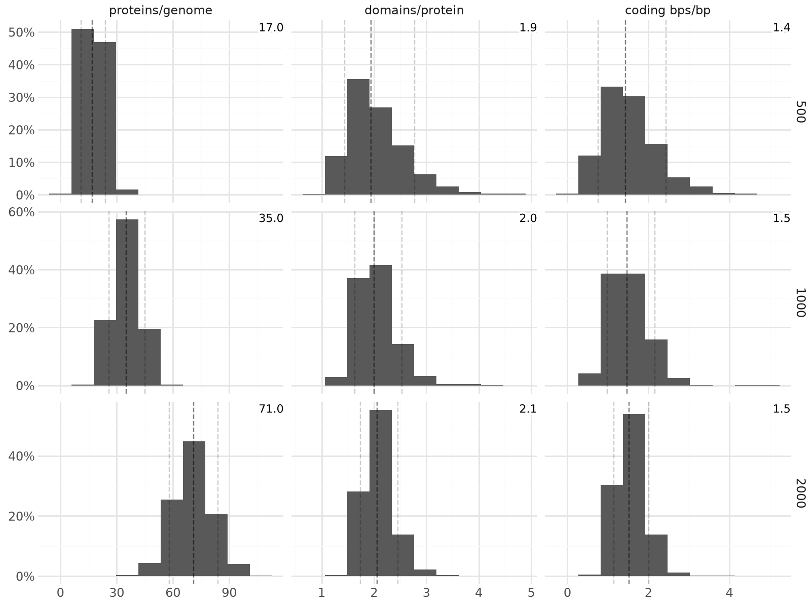
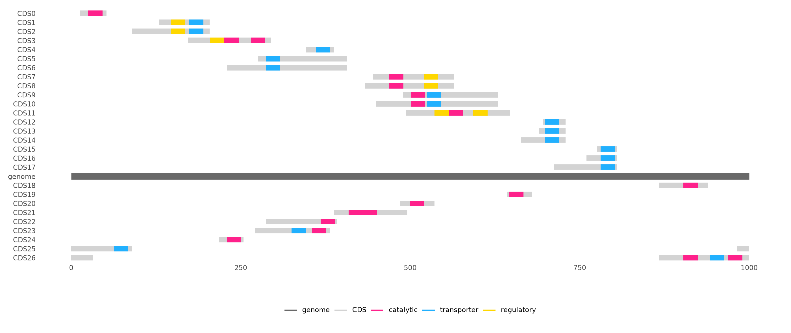
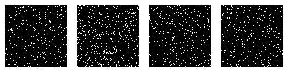
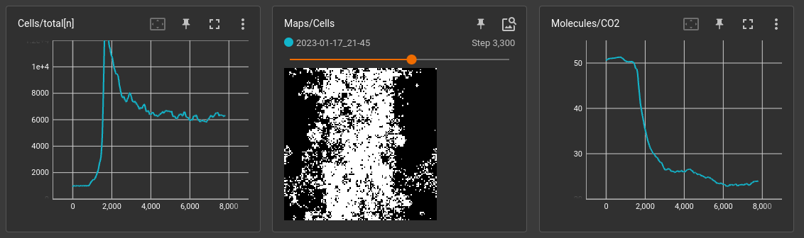

# Tutorials

## Simple Experiment

_MagicSoup_ is trying to provide only an engine for running the simulation.
Everything else should be up to the user so that any experimental setup can be created.
However, this also means a lot of code has to be written by yourself.
As a simple example let's try to teach cells to convert CO2 into acetyl-CoA.
Cell survival will be based on intracellular acetyl-CoA concentrations and CO2 will be supplied in abundance.

### Chemistry

The most important thing of our simulated world is the [Chemistry][magicsoup.chemistry.Chemistry] object.
It defines which [molecules][magicsoup.chemistry.Molecule] exist and how behave,
which [reactions][magicsoup.chemistry.Reaction] are possible and how much energy they release.

Here, we will use the [Wood-Ljungdahl pathway](https://en.wikipedia.org/wiki/Wood%E2%80%93Ljungdahl_pathway) as inspiration.
There are a few molecule species and reactions that eventually acetylate coenzyme A.
Below, we create a file _chemistry.py_ in which we define all these molecules and reactions.
For the sake of brevity some pathway steps were skipped.

```python
# chemistry.py
from magicsoup.chemistry import Chemistry, Molecule, Reaction

NADPH = Molecule("NADPH", 62, half_life=3, diffusivity=4e-6, permeability=0)
NADP = Molecule("NADP", 2, half_life=60, diffusivity=4e-6, permeability=0)
ATP = Molecule("ATP", 33, half_life=210, diffusivity=2.5e-6, permeability=0)
ADP = Molecule("ADP", 3, half_life=500, diffusivity=2.5e-6, permeability=0)

methylFH4 = Molecule("methyl-FH4", 199, half_life=0.5, diffusivity=3e-6, permeability=1e-9)
methylenFH4 = Molecule("methylen-FH4", 159, half_life=0.1, diffusivity=3e-6, permeability=1e-9)
formylFH4 = Molecule("formyl-FH4", 104, half_life=0.02, diffusivity=3e-6, permeability=1e-9)
FH4 = Molecule("FH4", 2, half_life=0.02, diffusivity=3e-6, permeability=1e-9)
formiat = Molecule("formiat", 77, half_life=-1, diffusivity=1.5e-5, permeability=1e-6)
co2 = Molecule("CO2", 10, half_life=-1, diffusivity=2e-5, permeability=1)

NiACS = Molecule("Ni-ACS", 2, half_life=0.001, diffusivity=6e-7, permeability=0)
methylNiACS = Molecule("methyl-Ni-ACS", 189, half_life=0.001, diffusivity=6e-7, permeability=0)
HSCoA = Molecule("HS-CoA", 51, half_life=0.4, diffusivity=3.5e-6, permeability=0)
acetylCoA = Molecule("acetyl-CoA", 200, half_life=42, diffusivity=3.5e-6, permeability=0)

molecules = [
    NADPH,
    NADP,
    ATP,
    ADP,
    methylFH4,
    methylenFH4,
    formylFH4,
    FH4,
    formiat,
    co2,
    NiACS,
    methylNiACS,
    HSCoA,
    acetylCoA,
]

reactions = [
    Reaction([co2, NADPH], [formiat, NADP]),
    Reaction([formiat, FH4, ATP], [formylFH4, ADP]),
    Reaction([formylFH4, NADPH], [methylenFH4, NADP]),
    Reaction([methylenFH4, NADPH], [methylFH4, NADP]),
    Reaction([methylFH4, NiACS], [FH4, methylNiACS]),
    Reaction([methylNiACS, co2, HSCoA], [NiACS, acetylCoA]),
]

chemistry = Chemistry(molecules=molecules, reactions=reactions)
```

Molecule are created with a hypothetical internal energy, the energy that would be released when fully deconstructing the molecule.
This energy is important for chemical reactions (see [Mechanics > Chemistry](./mechanics.md#chemistry)).
Apart from that half life, diffusion and permeability coefficients can be defined.

Reactions are defined as tuples of products and substrates.
However, all reactions are considered reversible (see [Mechanics > Kinetics](./mechanics.md#kinetics)).
So, defining ATP $\rightleftharpoons$ ADP is the same as defining ADP $\rightleftharpoons$ ATP.
Stoichiometric numbers greater 1 are expressed by listing the molecule species multiple times (e.g. `[ATP, ATP]` or `[ATP] * 2`).

### Setup

Eventually, we want to create a [Chemistry][magicsoup.chemistry.Chemistry]
and a [World][magicsoup.world.World] object and then step through time by repetitively calling different functions.
This is what our _main.py_ will look like:

```python
# main.py
import torch
import magicsoup as ms
from .chemistry import chemistry

def prepare_culture(world: ms.World) -> None:
    ...

def add_cells(world: ms.World) -> None:
    ...

def progress(world: ms.World) -> None:
    ...

def kill_cells(world: ms.World) -> None:
    ...

def divide_cells(world: ms.World) -> torch.Tensor:
    ...

def mutate_cells(world: ms.World, cells: torch.Tensor) -> None:
    ...

def main():
    world = ms.World(chemistry=chemistry)
    prepare_culture(world=world)
    add_cells(world=world)

    for _ in range(10_000):
        progress(world=world)
        kill_cells(world=world)
        divided = divide_cells(world=world)
        mutate_cells(world=world, cells=divided)

if __name__ == "__main__":
    main()
```

Here, we prepare the medium, add some cells, and let the simulation run for 10k steps.
In each step cells can catalyze reactions and molecules can diffuse.
Then cells are selectively killed and divided.
Dividing cells will experience mutations.

### Adding molecules

When [World][magicsoup.world.World] is instantiated by default the 2D map is empty.
Here, we add a baseline of all molecules with some extra CO2 and energy carriers.
Our cells don't have any mechanism for restoring these molecules.
Sooner or later they will run out of energy and CO2.

World molecule concentrations on the 2D map are described by tensor `world.culture.molecule_map` with shape `(m, N, N)`
where `m` refers to each molecule species (ordered as in `chemistry`) and `N` to the map size.
Concentrations are in mM (milli molar).
`chemistry` has some helpers for getting the correct molecule index.
I am using `chemistry.molname_2_idx`.

```python
def prepare_culture(world: ms.World) -> None:
    m2i = world.chemistry.molname_2_idx
    molecule_map = world.culture.molecule_map

    molecule_map[:] = 1
    molecule_map[m2i["ATP"]] = 10
    molecule_map[m2i["NADPH"]] = 10
    molecule_map[m2i["CO2"]] = 10
```

### Adding cells

So far, there are no cells yet.
Cells can be spawned with [spawn_cells()][magicsoup.world.World.spawn_cells]
by providing genomes.
They will be placed in random voxels on the map and take up their molecules.
There is a helper function [random_genome()][magicsoup.core.util.random_genome] that can be used to generate genomes of a certain size.

```python
def add_cells(world: ms.World) -> None:
    genomes = [ms.random_genome(s=500) for _ in range(1000)]
    world.spawn_cells(genomes=genomes)
```

### Progress

[advance_time()][magicsoup.world.World.advance_time] is the function to progress in time.
It lets molecules diffuse, permeate, degrade, and lets cell proteins catalyze reactions and transport molecules,
all by 1&nbsp;s (second) by default.
With `n_steps=10` time advances by 10s with every `progress()` call.

```python
def progress(world: ms.World) -> None:
    world.advance_time(n_steps=10)
```

### Killing cells

Selectively killing and dividing cells are the main levers for exerting evolutionary pressure.
Here, low intracellular ATP concentrations shall be used to kill cells.
`world.cells.molecules` is a `(c, m)` tensor that describes intracellular molecule concentrations
with `m` representing molecule species (ordered as in `chemistry`) and `c` representing cells.
Again `world.chemistry.molname_2_idx` is used to get the correct index for ATP.
When cells die, they spill their molecules onto the voxel.

```python
def kill_cells(world: ms.World) -> None:
    m2i = world.chemistry.molname_2_idx
    mask = world.cells.molecules[:, m2i["ATP"]] < 0.1
    world.kill_cells(mask=mask)
```

### Dividing cells

Dividing cells can be done similarly using [divide_cells()][magicsoup.world.World.divide_cells].
Here, high acetyl-CoA concentrations shall decide cell division.
The division itself shall cost some acetyl-CoA.
So, additional a term is added that converts some acetyl-CoA back to HS-CoA.
The returned tensor of `divide_cells` tells us which cells successfully divided.
We return this tensor for the next part.

```python
def divide_cells(world: ms.World) -> torch.Tensor:
    m2i = world.chemistry.molname_2_idx
    mask = world.cells.molecules[:, m2i["acetyl-CoA"]] > 0.5
    divided = world.divide_cells(mask=mask)

    world.cells.molecules[divided, m2i["acetyl-CoA"]] -= 0.3
    world.cells.molecules[divided, m2i["HS-CoA"]] += 0.3
    
    return divided
```

### Mutating cells

MagicSoup has a [Mutator][magicsoup.mutations.Mutator] class for introducing genome mutations.
It can be used with [mutate_cells()][magicsoup.world.World.mutate_cells] to efficiently mutate selected cells.
The new genomes of muated cells will automatically be translated and proteomes updated.
Here, we shall mutate all cells which divided.
Without specifying it, world's default mutator is used, which introduces
[point mutations](https://en.wikipedia.org/wiki/Point_mutation),
[replication slippage](https://en.wikipedia.org/wiki/Slipped_strand_mispairing),
and [homologous recombination](https://en.wikipedia.org/wiki/Homologous_recombination)
at reasonable rates.

```python
def mutate_cells(world: ms.World, cells: torch.Tensor) -> None:
    world.mutate_cells(mask=cells)
```

## Molecules

Molecules and molecule concentrations are one of the main handles for reading and influencing the simulations.
Molecule concentrations in the world map are managed on [Culture][magicsoup.culture.Culture] in `world.culture.molecule_map`
and intracellular molecule concentrations are managed on [Cells][magicsoup.cells.Cells] in `world.cells.molecules`.
Each tensor representing molecule concentrations has one dimension dedicated to each molecule species called `m`.
`world.culture.molecule_map` is a `(m, N, N)` tensor (with `N` being the map size)
and `world.cells.molecules` is a `(c, m)` tensor (with `c` representing cells).
The order of molecule species along `m` is the same as in `world.chemistry.molecules`.
So, if `world.chemistry.molecules[3]` is ATP, then `world.culture.molecule_map[3]` represents the map's ATP concentrations
and `world.cells.molecules[:, 3]` represents all cells' intracellular ATP concentrations.
[Chemistry][magicsoup.chemistry.Chemistry] includes several helper mapping for easily mapping molecule species to indices and _vice versa_.

When accessing and manipulating these tensors make sure to avoid copying the tensor or forcing host synchronization (also see [GPU and Tensors](#gpu-and-tensors)).
Also make sure to never introduce negative or infinite concentrations.
When subtracting values close to zero, account for floating point errors (around 1e-7 for floats) and [clamp](https://docs.pytorch.org/docs/2.15/generated/torch.clamp.html)
them to zero if in doubt.

Some tensors get re-created during the simulation.
E.g. tensors on [Cells][magicsoup.cells.Cells] grow and shrink with the number of cells.
So, a reference to `world.cells.molecules` after a call to [divide_cells()][magicsoup.world.World.divide_cells] 
or [compact()][magicsoup.world.World.compact] may not point to the current tensor anymore.

Finally, note that by default a voxel on the molecule map is 1&nbsp;pL (pico litre) while a cell is 1&nbsp;fL (femto litre).
So, the absolute amount of molecules is 1000 times higher in a voxel compared to a cell with the same concentration.

## Genomes

The simulation represents genomes as a 1-byte offset-buffer ([StrArray][magicsoup.core.strarray]) for performance.
They are managed on [Cells][magicsoup.cells.Cells] in `world.cells.genomes`.
For performance-oriented genome manipulations see the [Mutator][magicsoup.mutations.Mutator] implementation.
For operations outside the simulation hot path you can use plain python getters and setters (e.g. `world.cells.genomes[i] = "ACTG"`).
If you change genomes of existing cells by hand (without using one of the methods on `world`)
you have to call `world.cells.update_genomes` afterwards to make sure these genomes are translated into proteomes (see [update_genomes()][magicsoup.cells.Cells.update_genomes]).


_Compositions of random genomes of different lengths._

The genome transcription and translation machinery is amanaged in [Genomics][magicsoup.genomics.Genomics] and [Proteomics][magicsoup.proteomics.Proteomics].
This includes mappings that map codons to concrete protein domains (also see [Mechanics > Genetic](./mechanics.md#genetics)).
These mappings are generated once when [World][magicsoup.world.World] is instantiated and are unique to the object.
There are helper classes for interpreting genomes and proteomes.
Use [get_cell()][magicsoup.world.World.get_cell] to get a single [Cell][magicsoup.biology.Cell] representation.
Apart from basic information such as lineage, generation, intracellular molecule concentrations, this object also contains
a proteome represented as list of [Proteins][magicsoup.biology.Protein] with a list of domains each.


_Transcripttome visualized from a [Cell][magicsoup.biology.Cell] representation._

When spawning new cells you can generate random genomes (see [Adding cells](#adding-cells) above).
However, you can also engineer genomes that include specific genes.
[GenomeSynthesizer][magicsoup.synthesis.GenomeSynthesizer] is a tool for doing that.
Together with [ProteinSynthesizer][magicsoup.synthesis.ProteinSynthesizer] one can define a set of proteins with specific domains each.
Then each call to [generate()][magicsoup.synthesis.GenomeSynthesizer.generate] generates a genome with the desired proteins.

## Adaption

In the [Simple Experiment](#simple-experiment) above selection was driven by killing cells with low ATP and dividing cells with high acetyl-CoA.
It is very unlikely that the experiment actually produces the desired result.
Molecule concentration thresholds and experimental setup were chosen at random.
It is more likely that it will yield one of the following patterns:

- **Extinction without adaption** The initial population never grows and dies out.
  Replication is too difficult or survival is too hard.
- **Boom and bust** The initial population overgrows the map, then dies out.
  Cells exhaust a limiting resource but are not adapted to growing without it.



For evolutionary dynamics to even set in the experimental setup has to allow for indefinite generations of cells.
For the experimental setup above this means that space and resources need to be provided.
E.g. one could regularly kill a certain selection of cells to prevent the map from overgrowing
and regularly supply energy and the carbon source to allow continuous growth (passaging cells).
Then the mutation supply must be large enough to allow cells to adapt in time, but not too large to create a mutational meltdown.
Finally, the induced stress must be high enough to create the need for adaption, but not too high lead to extinction.
In the experiment above the cells has basically only a few generations to learn an entire pathway from a random genome.
A better approach would be to first create an experimental setup where cells grow at a reasonable then introduce stress at measured rates.

## Monitoring

One nice tool for monitoring an ongoing simulation is [TensorBoard](https://www.tensorflow.org/tensorboard).
It's an app that watches a directory and displays logged data as line charts, histograms, images and more.
It can be installed from [PyPI](https://pypi.org/project/tensorboard/).
_PyTorch_ already includes a `SummaryWriter` that can be used for writing these logging files.

```python
# main.py
import datetime as dt
from pathlib import Path
import torch
from torch.utils.tensorboard import SummaryWriter
import magicsoup as ms
from .chemistry import chemistry

THIS_DIR = Path(__file__).parent
...

def main():
    now = dt.datetime.now().strftime("%Y-%m-%d_%H-%M")
    writer = SummaryWriter(log_dir=THIS_DIR / "runs" / now)

    world = ms.World(chemistry=chemistry)
    ...

    for _ in range(10_000):
        ...

if __name__ == "__main__":
    main()
```

When it is instantiated it creates `log_dir` if it doesn't already exist.
This is where all the logging files will go (add it to `.gitignore` to avoid committing this directory).
In the example above the current date and time is added as a subdirectory,
so a run can be started multiple times without overriding the previous ones.

How to use the `SummaryWriter` is explained in [the docs](https://pytorch.org/docs/stable/tensorboard.html).
It supports a several data types.
Below it is used to record some scalars about cell growth and the cell map as a picture.
Accessing these values will force host synchronization, so don't do it on every step.

```python
# main.py
import datetime as dt
from pathlib import Path
import torch
from torch.utils.tensorboard import SummaryWriter
import magicsoup as ms
from .chemistry import chemistry

THIS_DIR = Path(__file__).parent
...

def write_scalars(world: ms.World, writer: SummaryWriter, step: int):
    writer.add_scalar("Cells/Total[n]", world.cells.get_n_cells(), step)
    writer.add_scalar("Cells/Age[avg]", world.cells.ages.mean(), step)
    writer.add_scalar("Cells/Generation[avg]", world.cells.generations.mean(), step)

def write_images(world: ms.World, writer: SummaryWriter, step: int):
    writer.add_image("Maps/Cells", world.culture.cell_map >= 0, step, dataformats="WH")

def main():
    now = dt.datetime.now().strftime("%Y-%m-%d_%H-%M")
    writer = SummaryWriter(log_dir=THIS_DIR / "runs" / now)

    world = ms.World(chemistry=chemistry)
    ...

    for step in range(10_000):
        ...
        if step % 10 == 0:
            write_scalars(world=world, writer=writer, step=step)
            if step % 100 == 0:
                write_images(world=world, writer=writer, step=step)

if __name__ == "__main__":
    main()
```

Note that `world.culture.cell_map` is a `(N, N)` tensor describing each voxel (row, column) with an index.
Voxels contain the index of a cell if it is occupied, and -1 if it is not occupied (also see [Culture][magicsoup.culture.Culture]).
So, `world.culture.cell_map >= 0` creates a binary map which will be shown as a black and white image.
The image dataformat is `WH` because dimension 0 of the map are rows and dimension 1 are columns.


_Watching 2 scalars and 1 image while a simulation is running_

## Checkpointing

[World][magicsoup.world.World] has some functions for saving (and loading) itself.
[save()][magicsoup.world.World.save] is used to save the whole world object as pickle file.
It can be restored using [from_file()][magicsoup.world.World.from_file].
However, during the simulation not everything on the world object changes.
A smaller and quicker way to save is [save_state()][magicsoup.world.World.save_state].
It only saves the parts which change when running the simulation (will write a few `.pt` and `.fasta` files).
A state can be restored with [load_state()][magicsoup.world.World.load_state].
So, in the beginning one [save()][magicsoup.world.World.save] is needed to save the whole object.
Then, [save_state()][magicsoup.world.World.save_state] can be used to save a certain time point.

```python
# main.py
import datetime as dt
from pathlib import Path
import torch
import magicsoup as ms
from .chemistry import chemistry

THIS_DIR = Path(__file__).parent
...

def main():
    outdir = THIS_DIR / "runs" / dt.datetime.now().strftime("%Y-%m-%d_%H-%M")
    outdir.mkdir(exist_ok=True, parents=True)

    world = ms.World(chemistry=chemistry)
    world.save(rundir=outdir)
    ...

    for step in range(10_000):
        ...
        if step % 100 == 0:
            world.save_state(statedir=outdir / f"step={step}")

if __name__ == "__main__":
    main()
```


## GPU and Tensors

[PyTorch](https://pytorch.org/) is used a lot in this simulation.
When initializing [World][magicsoup.world.World] parameter `device` can be used to move most calculations to a GPU.
_E.g._ with `device="cuda"` the default CUDA device is used (see [pytorch CUDA semantics](https://pytorch.org/docs/stable/notes/cuda.html)).
There is a [PyTorch tutorial](https://pytorch.org/tutorials/beginner/introyt/tensors_deeper_tutorial.html)
for working with tensors but in general you should try to use [tensor methods](https://pytorch.org/docs/stable/torch.html).
For tensor operations in the hot path of the simulation also make sure to avoid anything that forces host synchronization (see [NVIDIA guide](https://docs.nvidia.com/dl-cuda-graph/1.0/torch-cuda-graph/sync-free-code.html)).

```python
# float tensors on GPU get modified (fast)
world.molecule_map[0] = 10.0
world.cell_molecules[idx_tensor] += 1.0

world.cells.generations.float()  # fast: convert integer to float tensor on GPU (fast)
mean = values.mean()  # fast: calculate mean as 1-item float tensor on GPU (fast)
value = mean.item()  # slow: item() forces host sync and sends value to CPU

if world.cells.ages.mean() > 10:  # slow: calls item()
    ...

# subsetting tensor by boolean mask forces host sync
mask = world.cells.generations > 10  # fast: create bool tensor on GPU
world.cells.molecules[mask, 3] = 1.0  # slower: edits tensor on GPU but forces host sync
world.cells.molecules.masked_fill_(mask, 1.0)  # fast: edits tensor on GPU without host sync
```

